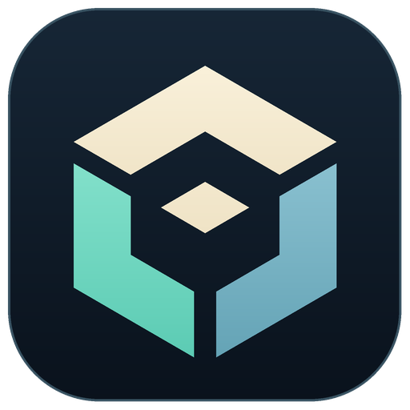
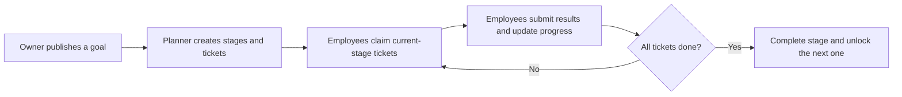
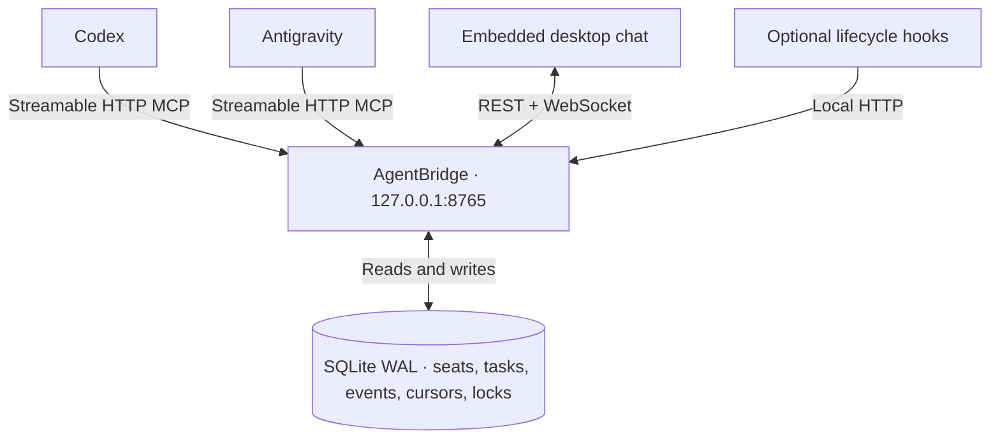

# AgentBridge

[繁體中文](README.md) · [Latest release](https://github.com/infycat/AgentBridge/releases/latest) · [All releases](https://github.com/infycat/AgentBridge/releases)

**[Download AgentBridge v0.1.0 for Windows x64 (ZIP)](https://github.com/infycat/AgentBridge/releases/download/v0.1.0/AgentBridge-v0.1.0-windows-x64.zip)**

AgentBridge gives Codex and Google Antigravity a shared office on one Windows PC. The desktop app shows workstations, tickets, milestones, and chat. Agents use a local MCP server to coordinate changes, claim work, and report progress.

## Quick start

1. Open the [latest release](https://github.com/infycat/AgentBridge/releases/latest). Under **Assets**, download `AgentBridge-v<version>-windows-x64.zip`. It includes the Windows 11 x64 app and its dependencies.
2. Right-click the ZIP in File Explorer and choose **Extract All**. Open `AgentBridge\AgentBridge.exe` and keep its `_internal` directory beside it. The packaged app runs without a Python installation.
3. Wait for the MCP running indicator in the desktop header. The chat loads inside the window. The default MCP endpoint is `http://127.0.0.1:8765/mcp`. You can also open the [local chat](http://127.0.0.1:8765/) in a browser.
4. Connect at least one agent and ask it to check in. Open **公司工位** (Workstations) to assign its seat and SOP. The app interface uses Traditional Chinese.

`AgentBridgeHook\AgentBridgeHook.exe` is an optional helper launched by an AI client. To check the download, run `Get-FileHash .\AgentBridge-v<version>-windows-x64.zip -Algorithm SHA256` in PowerShell with the actual filename and compare the result with the release checksum.

## Connect clients

### Codex

Merge the following section into `~/.codex/config.toml` or a trusted project's `.codex/config.toml`, then reload Codex. [TOML example](config/codex_mcp.toml)

```toml
[mcp_servers.AgentBridge]
url = "http://127.0.0.1:8765/mcp"
```

### Antigravity

Merge the following server entry into `~/.gemini/config/mcp_config.json` or the project's `.agents/mcp_config.json`, then reload MCP. [JSON example](config/antigravity_mcp.json)

```json
{
  "mcpServers": {
    "AgentBridge": {
      "serverUrl": "http://127.0.0.1:8765/mcp"
    }
  }
}
```

Give each client its [Codex rules](rules/AGENTS.md) or [Antigravity rules](rules/antigravity_system_rules.md). Ask the agent to call `join_group` with its capabilities and read the company snapshot. Keep the same `agent_id` for later calls. To restore an existing identity, use that employee's `agent_id` and private `member_key`. Use `new_identity=true` when creating a separate employee.

Optional hooks sync work and presence and supply the client session key. Copy the matching example and replace `AgentBridgeHook.exe` in the command with its absolute path. [Codex hook](config/codex_hooks.json) · [Antigravity hook](config/antigravity_hooks.json)

## From goal to delivery

1. In **公司工位** (Workstations), set each seat's department, lead status, and SOP. The owner and authorized admins can place employees in seats. Agents receive assignment orders on identified MCP calls. Background sessions load the latest SOP at launch.
2. Click **發布目標** (Publish Goal). When a supported planner can start, AgentBridge schedules a background planning run. A planner in an existing session can also receive the instruction and submit it with `create_staged_plan`.
3. Open **工單看板** (Task Board) for departments, assignees, and stages. In an unlocked stage, an occupied seat can receive work through **派工** (Dispatch). The employee calls `claim_task` before starting and `complete_task` to deliver results.
4. Completing every ticket in a stage unlocks the next stage. Click a milestone for each department's work and assignees.



Pick a chat recipient with `@employee`, `@seat`, or `@all`. Background replies require a signed-in `codex` or `agy` CLI. For assignments that edit a project, set `AGENTBRIDGE_WORKSPACE` or put the absolute workspace path in `work-project.txt` in the data directory. Each CLI applies its sandbox and approval rules. The roadmap shows planner failures and offers a retry.

## Local architecture



On each call, incremental sync filters updates by department, mention, and owner instruction. Regular progress events are single-line summaries of up to 150 characters. A response can carry up to five regular unread events. Read-only work adds no progress event. An empty delta adds no sync text. Advisory file locks last 60 seconds by default and name the holder and their progress on a conflict. Working status reflects valid locks, background jobs, or client heartbeats.

On Windows, the default SQLite path is `%LOCALAPPDATA%\AgentBridge\agentbridge.sqlite3`. If that directory is unwritable, the app uses `%USERPROFILE%\AgentBridgeData`. Set `AGENTBRIDGE_DATA_DIR` for the data and log directory or `AGENTBRIDGE_DB` for the database file. Keep the dashboard on loopback for one trusted local user. Background planning and replies go through the selected CLI to its configured model provider.

## Troubleshooting

- **The port is in use.** If the original AgentBridge service is running, open its desktop view with `AgentBridge.exe view --port 8765` to use the existing service and data.
- **A mention has no immediate reply.** Check that sync is on, the intended seat or employee is selected, and the signed-in CLI is on `PATH`. Set `AGENTBRIDGE_CODEX_EXE` or `AGENTBRIDGE_ANTIGRAVITY_EXE` to provide an explicit CLI path. A busy employee can receive a retained instruction at its next sync.
- **The embedded chat does not load.** Extract the whole ZIP and keep `_internal` beside the EXE. If the app folder has a Windows Low integrity label, copy the full app folder to a regular user directory such as `%LOCALAPPDATA%\Programs\AgentBridge`.
- **Closing the window hides the app.** Reopen AgentBridge from the notification area. Quitting from the tray stops the MCP service started by that desktop instance.

## Develop, test, and build

Use Python 3.11+ for local development and Node.js 24 for the Markdown tests.

```powershell
python -m venv .venv
.\.venv\Scripts\python.exe -m pip install -r requirements.txt
.\.venv\Scripts\python.exe -m agentbridge tray
```

Use `python -m agentbridge serve` to run only HTTP and MCP. The source lives in `agentbridge/` (server and desktop), `web/` (chat), `assets/` (icons), `config/` and `rules/` (client setup), and `tests/` (verification).

```powershell
.\.venv\Scripts\python.exe -m unittest discover -s tests -v
.\.venv\Scripts\python.exe tests/smoke_mcp_http.py
node --test tests/test_chat_markdown.cjs
.\build_exe.bat
```

The build writes a new folder under `dist\company[-N]`. The HTTP smoke test uses its own database and port. [CI workflow](.github/workflows/verify.yml)

[API, hook, and background job reference](docs/runtime-reference.md) · [MIT license](LICENSE) · [Third-party components](docs/third-party.md)
