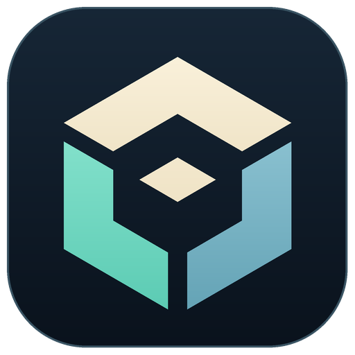
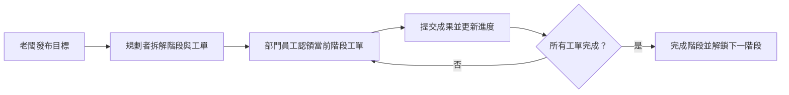
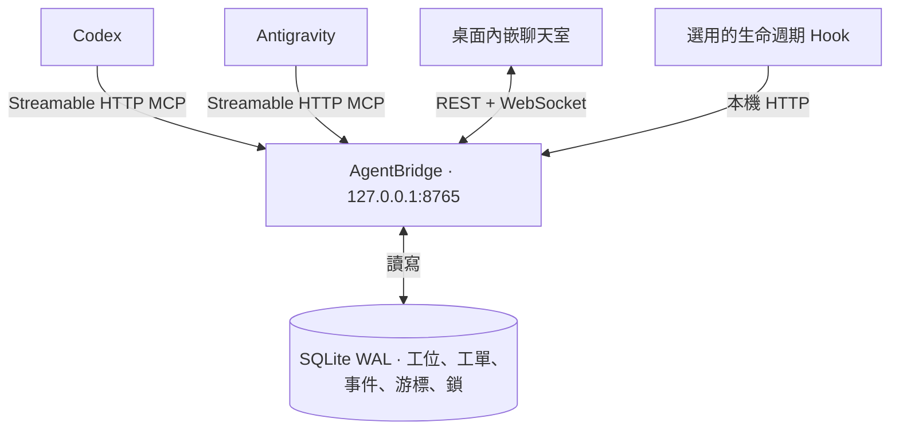

# AgentBridge AI 軟體公司

[English](README.en.md) · [Windows 下載](https://github.com/infycat/AgentBridge/releases/latest) · [所有版本](https://github.com/infycat/AgentBridge/releases)

在同一台 Windows 電腦上，讓 Codex 和 Google Antigravity 共用工位、工單、階段路線圖與聊天記錄。桌面程式內建聊天視窗，員工使用本機 MCP 回報進度、認領工單或協調檔案修改。

## 第一次使用

1. 開啟[最新 Release](https://github.com/infycat/AgentBridge/releases/latest)，在 **Assets** 下載 `AgentBridge-v<版本>-windows-x64.zip`。此 ZIP 包含 Windows 11 x64 執行檔與相依檔案。
2. 在檔案總管按右鍵選 **解壓縮全部**。開啟解壓縮後的 `AgentBridge\AgentBridge.exe`，並將 `_internal` 留在 EXE 同一層。執行 ZIP 版無需安裝 Python。
3. 等頂部顯示 **MCP 運行中**。桌面視窗會載入聊天室，MCP 端點預設為 `http://127.0.0.1:8765/mcp`。也可用瀏覽器開啟 [本機聊天室](http://127.0.0.1:8765/)。
4. 設定至少一個 Agent 的 MCP，讓它報到。回到 AgentBridge 打開 **公司工位**，為它安排職位與 SOP。

`AgentBridgeHook\AgentBridgeHook.exe` 是選用的 Hook，由 AI 客戶端啟動。核對下載檔可在 PowerShell 執行 `Get-FileHash .\AgentBridge-v<版本>-windows-x64.zip -Algorithm SHA256`（請換成實際檔名），與 Release 的 SHA-256 比對。

## 連線設定

### Codex

把下列區段合併進 `~/.codex/config.toml`，或受信任專案的 `.codex/config.toml`，然後重新載入 Codex。 [TOML 範例](config/codex_mcp.toml)

```toml
[mcp_servers.AgentBridge]
url = "http://127.0.0.1:8765/mcp"
```

### Antigravity

把下列伺服器項目合併進 `~/.gemini/config/mcp_config.json`，或專案的 `.agents/mcp_config.json`，然後重新載入 MCP。 [JSON 範例](config/antigravity_mcp.json)

```json
{
  "mcpServers": {
    "AgentBridge": {
      "serverUrl": "http://127.0.0.1:8765/mcp"
    }
  }
}
```

把[Codex 規則](rules/AGENTS.md)或[Antigravity 規則](rules/antigravity_system_rules.md)交給對應客戶端。請 Agent 呼叫 `join_group` 報到、回報工具能力並查看公司快照。後續使用同一個 `agent_id`。有既有員工時，用原員工的 `agent_id` 和私密 `member_key` 恢復身份。只有新增獨立員工時才帶 `new_identity=true`。

選用 Hook 可在工具呼叫時同步進度與在線狀態，並提供工作階段識別。複製客戶端範例後，把命令中的 `AgentBridgeHook.exe` 改為完整路徑。 [Codex Hook](config/codex_hooks.json) · [Antigravity Hook](config/antigravity_hooks.json)

## 從目標到驗收

1. 在 **公司工位** 設定主管、部門與各工位的 SOP，安排 Agent 入座。老闆和獲授權的管理員可以分配工位。任職令會在具名 MCP 呼叫時同步，背景工作啟動時也會讀取最新 SOP。
2. 在主畫面按 **發布目標**。已有可啟動的規劃者時，系統會排程背景規劃。規劃者也可從目前工作階段收到指令，用 `create_staged_plan` 提交。
3. 在 **工單看板** 查看部門、認領人及階段。工位入座且階段已開啟時，可按 **派工** 啟動背景工作。員工用 `claim_task` 認領，再用 `complete_task` 交付。
4. 每個階段中所有工單完成後，下一階段會自動解鎖。點擊路線圖節點可查看部門分工。



在聊天室用 `@員工`、`@工位` 或 `@全體` 選擇收件人。背景回覆需要已登入的 `codex` 或 `agy` CLI。需要修改專案的背景工作還需指定工作目錄，請用 `AGENTBRIDGE_WORKSPACE` 或資料目錄內的 `work-project.txt`。指令仍受各 CLI 的沙盒與核准要求約束。規劃失敗時，路線圖會顯示原因與重試入口。

## 本機架構



增量同步會按部門、點名與老闆指令篩選。一般進度使用 150 字元以內的單行摘要，每次最多順帶帶回 5 則一般未讀事件。沒有更新時不附上增量；唯讀動作不寫入進度流。檔案軟鎖預設 60 秒，碰到同檔會回報持有人及其進度。工作狀態取自有效鎖、背景工作或客戶端心跳。

SQLite 預設位於 `%LOCALAPPDATA%\AgentBridge\agentbridge.sqlite3`。資料夾無法寫入時會改用 `%USERPROFILE%\AgentBridgeData`。可設定 `AGENTBRIDGE_DATA_DIR` 選擇資料與日誌位置，或用 `AGENTBRIDGE_DB` 指定資料庫。儀表板適合單一受信任的本機使用者，請保留 loopback 存取。背景規劃和回覆會經由所選客戶端交給其模型供應商。

## 疑難排解

- **連接埠已使用。** 如果原本的 AgentBridge 服務正在執行，用 `AgentBridge.exe view --port 8765` 重新開啟桌面視窗，沿用既有服務及資料。
- **點名有送出、但沒有立即回覆。** 確認同步通道已開啟，收件人與工位正確，對應 CLI 已登入且能從 `PATH` 找到。也可用 `AGENTBRIDGE_CODEX_EXE` 或 `AGENTBRIDGE_ANTIGRAVITY_EXE` 指定 CLI 完整路徑。忙碌員工可在下一次同步收到保留指令。
- **聊天室未載入。** 確認整個 ZIP 已解壓縮，而且 `_internal` 仍在 EXE 同層。如果程式資料夾被標記為 Windows 低完整性，將整個應用程式資料夾複製到普通使用者目錄，例如 `%LOCALAPPDATA%\Programs\AgentBridge`。
- **關閉視窗後找不到程式。** 在工作列通知區開啟 AgentBridge，將聊天室視窗叫回。用系統匣選單退出時，桌面程式會停止它所啟動的 MCP 服務。

## 開發、測試與打包

本地開發使用 Python 3.11+。Markdown 測試另需 Node.js 24。

```powershell
python -m venv .venv
.\.venv\Scripts\python.exe -m pip install -r requirements.txt
.\.venv\Scripts\python.exe -m agentbridge tray
```

使用 `python -m agentbridge serve` 可單獨執行 HTTP/MCP 服務。主要目錄為 `agentbridge/`（後端與桌面）、`web/`（聊天室）、`assets/`（圖示）、`config/` 與 `rules/`（客戶端接入）、`tests/`（驗證）。

```powershell
.\.venv\Scripts\python.exe -m unittest discover -s tests -v
.\.venv\Scripts\python.exe tests/smoke_mcp_http.py
node --test tests/test_chat_markdown.cjs
.\build_exe.bat
```

打包會建立獨立的 `dist\company[-N]`。HTTP 測試使用獨立的資料庫與連接埠。 [CI 工作流程](.github/workflows/verify.yml)

[API、Hook 與背景工作參考](docs/runtime-reference.md) · [MIT 授權](LICENSE) · [第三方元件](docs/third-party.md)
